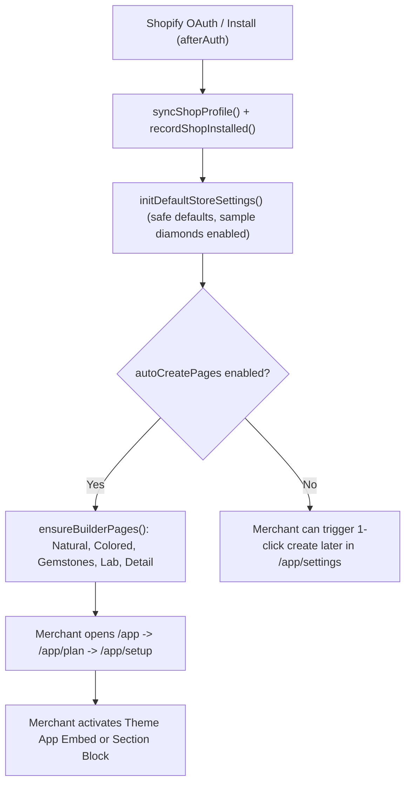
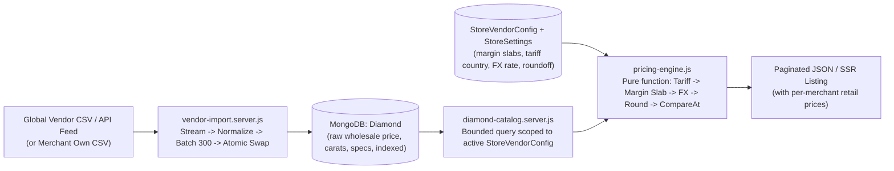
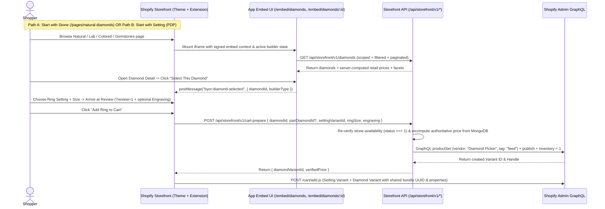

# Diamond Builder — Target Architecture, Current State & Modular Rebuild Blueprint

> **Purpose**: Authoritative technical blueprint for **Diamond Builder** (`e:\new rdb\Diamond-Builder`). This document inventories **everything currently built** in this repository and defines how to cleanly engineer the full Build-Your-Own-Ring (BYOR) multi-platform capabilities extracted from [RING_BUILDER_V1_ARCHITECTURE.md](./RING_BUILDER_V1_ARCHITECTURE.md) using **fresh, modular, secure, and enable-first code** inside our existing React Router 7 + Prisma + MongoDB + Shopify CLI stack.

---

## 1. Core Architectural Principles

1. **Fresh Code Only — Never Port Legacy Anti-Patterns**:
   - Port **capabilities and business rules** from V1, never legacy code.
   - No jQuery / jQuery UI monoliths, no raw Mongoose duplicate models, no plaintext URL login tokens, no unauthenticated cron/delete routes, no duplicated `.min.js`/`.min.css` manual files, and **zero hardcoded `.myshopify.com` domain branches**.
2. **Keep Everything Intact**:
   - Preserve existing working subsystems: Shopify OAuth + App Bridge v4 shell, Prisma MongoDB singleton pool ([app/db.server.js](./app/db.server.js)), GraphQL subscription billing, Super Admin RBAC panel (`/admin`), CSV vendor feed importer, compliance webhooks, and the existing `npm test` suite (81 passing assertions).
3. **"Enable-First" Modularity & Flexibility**:
   - Every major capability (Builder Verticals: Ring / Pendant / Earring, Diamond Categories, Auto-Page Provisioning, Tiered Margins, Filters, Engraving, Virtual Try-On, PDF Redaction, Drop-a-Hint, Theme App Embed) is gated behind **explicit per-store capability flags** (`StoreSettings`) and **plan entitlements** (`Plan.entitlements`).
   - Installing the app never breaks or alters a merchant's storefront until the merchant enables the embed/block or turns on a module. Disabled modules fail closed on the server and render zero storefront payload.
4. **Platform-Neutral Core + Thin Adapters**:
   - Follow [ARCHITECTURE.md](./ARCHITECTURE.md) and [BYOR-REQUIREMENTS.md](./BYOR-REQUIREMENTS.md): shared business logic lives in `app/features/*`; platform-specific auth, pages, and cart mutations live in `app/integrations/<platform>/*`; routes in `app/routes/` remain thin HTTP boundaries.
5. **MongoDB Performance Rules ([AGENTS.md](./AGENTS.md))**:
   - Always reuse `prisma` from `app/db.server.js`.
   - Select only required fields, enforce bounded pagination (`take <= 25`/`100`), avoid N+1 queries inside loops, and design compound indexes around actual filter/sort predicates.
6. **Built for Shopify Backend UI & Sidekick AI ([AGENTS.md](./AGENTS.md))**:
   - Build all merchant admin screens (`app/routes/app*.jsx`) exclusively with official Polaris Web Components and App Bridge v4 (`useAppBridge()`, `<s-app-nav>`), hiding internal Shopify Page/Collection IDs from visible UI while using them under the hood and surfacing live storefront URLs.
   - Keep Sidekick App Extensions (`admin.app.tools.data`, `admin.app.intent.link`, `[sidekick]`) concise, policy-compliant, and served with `https://extensions.shopifycdn.com` CORS support.

---

## 2. Current Project Inventory (What Is Built Today)

Diamond Builder is scaffolded on **React Router 7.18 + Vite 6 + Node.js**, using **Polaris Web Components** (`<s-page>`, `<s-section>`, `<s-button>`), **App Bridge v4**, and **Prisma 6 + MongoDB Atlas**.

### 2.1 Existing Modules & Verified File Map

| Domain                                 | Existing Files                                                                                                                                                                                                                                                                                                                                                                                                                                                                 | Current Status & Behavior                                                                                                                                                                                                                                                                                                                       |
| :------------------------------------- | :----------------------------------------------------------------------------------------------------------------------------------------------------------------------------------------------------------------------------------------------------------------------------------------------------------------------------------------------------------------------------------------------------------------------------------------------------------------------------- | :---------------------------------------------------------------------------------------------------------------------------------------------------------------------------------------------------------------------------------------------------------------------------------------------------------------------------------------------- |
| **App Config & Shopify Core**          | [shopify.app.toml](./shopify.app.toml), [shopify.web.toml](./shopify.web.toml), [vite.config.js](./vite.config.js), [app/shopify.server.js](./app/shopify.server.js), [app/db.server.js](./app/db.server.js), [app/root.jsx](./app/root.jsx), [app/entry.server.jsx](./app/entry.server.jsx)                                                                                                                                                                                   | Configured with `read_themes,write_products,write_metaobjects,write_metaobject_definitions,write_content`, API `2027-01` / `ApiVersion.July26`, Vite 6 tunnel support (`allowedHosts`), `authenticateAdminOrDiagnose`, and `afterAuth` hooks.                                                                                                   |
| **Database Schema**                    | [prisma/schema.prisma](./prisma/schema.prisma)                                                                                                                                                                                                                                                                                                                                                                                                                                 | 12 MongoDB models implemented: `Session`, `AppSubscription`, `SetupVerification`, `SupportTicket`, `ShopProfile`, `StaffUser`, `ShopInstallation`, `ShopEvent`, `Plan`, `Vendor`, `DiamondImport`, `Diamond` (indexed on `vendorId`, `status`, `shape`, `colore`, `cut`, `certificate`, `price`, `carats`, `updatedAt`, `ReportNo`, `stockId`). |
| **Billing & Plans**                    | [app/billing.server.js](./app/billing.server.js), [app/plans.server.js](./app/plans.server.js), [app/lib/plans.js](./app/lib/plans.js), [app/lib/billing.js](./app/lib/billing.js), [app/routes/app.plan.jsx](./app/routes/app.plan.jsx), [scripts/sync-byor-plans.mjs](./scripts/sync-byor-plans.mjs)                                                                                                                                                                         | 3 server-authoritative tiers (`free` $0, `basic` $39/$390, `advance` $110/$1100, 14-day trial) synced with Mongo `Plan` collection and Shopify GraphQL `appSubscriptionCreate`.                                                                                                                                                                 |
| **Merchant Admin Shell & Onboarding**  | [app/routes/app.jsx](./app/routes/app.jsx), [app/routes/app._index.jsx](./app/routes/app._index.jsx), [app/routes/app.setup.jsx](./app/routes/app.setup.jsx), [app/setup.server.js](./app/setup.server.js), [app/routes/app.help.jsx](./app/routes/app.help.jsx), [app/support.server.js](./app/support.server.js), [app/lib/faq.js](./app/lib/faq.js)                                                                                                                         | Authenticated shell reconciles subscriptions, syncs `ShopProfile`, verifies storefront/theme script placement (`read_themes` + HTML fallback), handles support tickets, and auto-provisions builder pages.                                                                                                                                      |
| **Super Admin Portal (`/admin`)**      | [app/admin-auth.server.js](./app/admin-auth.server.js), [app/routes/admin.jsx](./app/routes/admin.jsx), [app/routes/admin_.login.jsx](./app/routes/admin_.login.jsx), [app/routes/admin._index.jsx](./app/routes/admin._index.jsx), [app/routes/admin.shops.jsx](./app/routes/admin.shops.jsx), [app/routes/admin.staff.jsx](./app/routes/admin.staff.jsx), [app/routes/admin.tickets.jsx](./app/routes/admin.tickets.jsx), [app/installs.server.js](./app/installs.server.js) | Independent scrypt-authenticated staff console with RBAC (`SUPER_ADMIN`, `ADMIN`, `SUPPORT`, `VIEWER`), shop lifecycle history (`ShopInstallation` + `ShopEvent`), and ticket triage.                                                                                                                                                           |
| **Vendor Feeds & Diamond Ingestion**   | [app/routes/admin.feeds.vendors.jsx](./app/routes/admin.feeds.vendors.jsx), [app/routes/admin.feeds.diamonds.jsx](./app/routes/admin.feeds.diamonds.jsx), [app/vendor-import.server.js](./app/vendor-import.server.js), [app/features/diamonds/diamond-title.js](./app/features/diamonds/diamond-title.js)                                                                                                                                                                     | Supports 5 categories (`Natural`, `Lab Grown Natural`, `Lab Grown Colored`, `Gemstones`, `Colored Diamonds`). Streams CSV up to 25 MB, normalizes shapes/colors/cuts/certificates/culet/fluorescence, batches inserts (`300`), and atomically swaps `status: 0 -> 1` while deleting old `status: 2`.                                            |
| **Storefront Embed & Theme Extension** | [app/routes/embed.diamonds.jsx](./app/routes/embed.diamonds.jsx), [app/integrations/shopify/pages.server.js](./app/integrations/shopify/pages.server.js), [extensions/theme-extension/blocks/builder.liquid](./extensions/theme-extension/blocks/builder.liquid), [extensions/theme-extension/blocks/diamond_builder_embed.liquid](./extensions/theme-extension/blocks/diamond_builder_embed.liquid)                                                                           | Early storefront `/embed/diamonds` listing route (shape, cut, color, clarity, sort, pagination, `byor:resize` & `byor:diamond-selected` postMessage), idempotent 5-page creator on install/load, and section + body App Embed blocks.                                                                                                           |
| **Webhooks & Compliance**              | [app/routes/webhooks.app.uninstalled.jsx](./app/routes/webhooks.app.uninstalled.jsx), [app/routes/webhooks.app.scopes_update.jsx](./app/routes/webhooks.app.scopes_update.jsx), [app/routes/webhooks.app_subscriptions.update.jsx](./app/routes/webhooks.app_subscriptions.update.jsx), [app/routes/webhooks.compliance.jsx](./app/routes/webhooks.compliance.jsx), [app/shop-data.server.js](./app/shop-data.server.js)                                                       | HMAC-verified webhooks handling uninstall tracking, scope updates, subscription updates, and `shop/redact` database cleanup.                                                                                                                                                                                                                    |
| **Automated Tests**                    | `app/lib/*.test.js`, `app/lib/admin/*.test.js`, [app/integrations/shopify/pages.test.js](./app/integrations/shopify/pages.test.js)                                                                                                                                                                                                                                                                                                                                             | `npm test` runs 81 passing `node:test` assertions covering plans, billing, scripts, verify, support, shop-profile, and Shopify page provisioning (plus unit tests under `app/lib/admin/`).                                                                                                                                                      |

### 2.2 Gap Analysis: What Remains to Complete the Platform

1. **Per-Store Enablement & Settings Layer**: No `StoreSettings`, `StoreVendorConfig`, or `FilterConfig` models yet; currently `embed.diamonds.jsx` queries global enabled vendors directly without per-merchant pricing, visibility, or feature toggles.
2. **Dynamic Pricing, Margin Slabs, Tariffs & Multi-Currency**: No margin tier evaluator, US/AU tariff calculator, compare-at pricing, rounding, or FX currency conversion yet.
3. **Full Customer BYOR Flow**: No stone detail view (`/embed/diamonds/:id`), procedural SVG structure schematics, 4C interactive scales, Ring/Pendant/Earring setting selection, PDP setting hijack, `?review=1` summary + engraving, or matched-pair earring lookup.
4. **JIT Checkout & Order Lifecycle**: No Just-In-Time Shopify `productSet` diamond materialization, paired line-item cart bundling, orphan item removal, or `orders/create` sold-stone (`status: 2`) webhook archival.
5. **Storefront Assets Pipeline & Security**: Theme extension scripts need a clean TypeScript/Vite build into `extensions/theme-extension/assets/` and signed embed verification (`HMAC` / App Proxy) instead of raw open query params.
6. **Value-Added Features & Analytics**: No Virtual Ring Try-On viewer, Certificate PDF redaction, Drop-a-Hint / Consult Expert, multi-language + RTL dictionary, or merchant sales funnel analytics.

---

## 3. Target Single-Repo Directory Structure

All new modules integrate directly into the existing React Router 7 repository while preserving every current route, test, and folder ownership boundary.

```text
Diamond-Builder/
├── package.json                                  # Root scripts + theme-extension asset bundle build
├── shopify.app.toml                              # App config, scopes, app proxy, webhooks
├── prisma/
│   └── schema.prisma                             # Existing 12 models + additive BYOR & store config models
├── extensions/
│   └── theme-extension/
│       ├── shopify.extension.toml
│       ├── blocks/
│       │   ├── builder.liquid                    # Section block (adds listing/builder to any template)
│       │   └── diamond_builder_embed.liquid      # App embed (target: body) — boots only when enabled
│       ├── src/                                  # Clean modular JS/TS source (no jQuery dependency)
│       │   ├── bridge.js                         # Host <-> Iframe postMessage protocol + auto-resize
│       │   ├── pdp-hijack.js                     # Setting PDP hijack ("Choose This Setting") + ring size
│       │   ├── cart-bundle.js                    # JIT /cart/add.js bundler + paired orphan item removal
│       │   └── styles/embed-host.css             # Minimal host theme container variables
│       └── assets/                               # Built bundles + static shape/cert sprites
├── app/
│   ├── db.server.js                              # Shared Prisma singleton (existing)
│   ├── shopify.server.js                         # Shopify app + hooks (existing)
│   │
│   ├── features/                                 # PLATFORM-NEUTRAL DOMAIN CORE (no Shopify SDK imports)
│   │   ├── settings/
│   │   │   ├── store-settings.server.js          # Resolve StoreSettings + Plan.entitlements + feature flags
│   │   │   └── feature-flags.js                  # Pure flag evaluators (isBuilderEnabled, canUseFeature)
│   │   ├── pricing/
│   │   │   ├── pricing-engine.js                 # Pure margin slab, US/AU tariff, FX, roundoff, compareAt
│   │   │   ├── pricing-engine.test.js
│   │   │   └── currency.server.js                # FX rate sync & lookup from CurrencyRate collection
│   │   ├── diamonds/
│   │   │   ├── diamond-title.js                  # Existing title formatter
│   │   │   ├── diamond-catalog.server.js         # Scoped bounded Mongo queries, facets, pair & similar lookup
│   │   │   ├── diamond-svg.js                    # Pure top-down (10 shapes) & side-profile SVG generator
│   │   │   └── diamond-constants.js              # Canonical shapes, 4C scales, labs, gemstone types
│   │   ├── listing/
│   │   │   ├── components/
│   │   │   │   ├── BuilderStepper.jsx            # Step 1 (Stone) / Step 2 (Setting) / Step 3 (Complete)
│   │   │   │   ├── DiamondFilters.jsx            # Shape icons, log price/carat sliders, 4C & advance drawers
│   │   │   │   ├── DiamondGrid.jsx               # Card grid + hover 360/MP4 preview + compare/recent triggers
│   │   │   │   ├── DiamondTable.jsx              # Sortable table view
│   │   │   │   ├── DiamondDetail.jsx             # Gallery, SVG diagrams, 4C scales, similar stones, actions
│   │   │   │   ├── BuilderReview.jsx             # Setting + Stone summary, engraving studio, Add to Cart
│   │   │   │   └── RingSettingPicker.jsx         # In-builder setting catalog (for iframe/non-Shopify/direct)
│   │   │   └── state/
│   │   │       └── builder-storage.js            # Typed state contract (ring | pendant | earring + engraving)
│   │   ├── tryon/
│   │   │   └── VirtualTryOn.jsx                  # Hand skin-tone, carat scale & setting head/shank viewer
│   │   ├── certificates/
│   │   │   └── redact-pdf.server.js              # Conditional vendor/report redaction + short-lived cache
│   │   └── i18n/
│   │       ├── translator.js                     # 4-layer translation merge + RTL helper
│   │       └── locales/                          # Base JSON packs (en, en_gb, fr, de, es, it, he)
│   │
│   ├── integrations/                             # PLATFORM ADAPTERS
│   │   ├── shopify/
│   │   │   ├── embed-context.server.js           # Verify App Proxy HMAC / signed embed token -> MerchantContext
│   │   │   ├── pages.server.js                   # Existing idempotent 5-page creator (flag-aware)
│   │   │   ├── cart-jit.server.js                # Atomic GraphQL productSet + publish + inventorySetQuantities
│   │   │   ├── product-reconcile.server.js       # Archive sold diamonds & sync active Diamond Picker prices
│   │   │   └── ring-catalog.server.js            # Optional curated/collection ring setting sync
│   │   ├── wordpress/                            # Future WooCommerce context + cart adapter
│   │   └── bigcommerce/                          # Future BigCommerce context + cart adapter
│   │
│   ├── jobs/                                     # BACKGROUND INGESTION & MAINTENANCE (protected)
│   │   ├── feed-scheduler.server.js              # Plan-quota-enforced CSV/API feed runner
│   │   ├── fx-sync.server.js                     # Daily currency rate update
│   │   └── lifecycle-notifications.server.js     # Support / drop-hint / trial emails
│   │
│   └── routes/                                   # THIN REACT ROUTER ENTRY POINTS (flatRoutes)
│       ├── app.jsx, app._index.jsx, app.plan.jsx, app.setup.jsx, app.help.jsx   # Existing merchant shell
│       ├── app.settings.jsx                      # Merchant builder toggles, pages, appearance & ring sizes
│       ├── app.vendors.jsx                       # Merchant per-category vendor activation, CSV & margin slabs
│       ├── app.filters.jsx                       # Merchant filter visibility, min/max bounds & default sort
│       ├── app.languages.jsx                     # Merchant language, RTL & translation overrides
│       ├── app.analytics.jsx                     # BYOR funnel stats (views -> select -> cart -> orders)
│       ├── admin*.jsx                            # Existing Super Admin console (+ Store Feature Flag overrides)
│       ├── embed.diamonds.jsx                    # Shared Customer Diamond Listing (existing -> enhanced)
│       ├── embed.diamonds.$id.jsx                # Shared Customer Stone Detail page
│       ├── embed.settings.jsx                    # Shared Customer Ring/Pendant/Earring Setting selector
│       ├── embed.review.jsx                      # Shared Customer Review & Engraving summary
│       ├── embed.try-on.jsx                      # Virtual Ring Try-On viewer iframe
│       ├── api.storefront.v1.diamonds.jsx        # Paginated scoped catalog API
│       ├── api.storefront.v1.cart-prepare.jsx    # Server price verification + JIT Shopify productSet
│       ├── api.storefront.v1.certificate.jsx     # Certificate proxy / PDF redaction stream
│       ├── api.storefront.v1.drop-hint.jsx       # Drop-a-Hint persistence + email trigger
│       ├── api.storefront.v1.events.jsx          # Funnel telemetry logger (`byor`, `add_to_cart`, `compare`)
│       ├── api.internal.cron.jsx                 # Bearer-secret protected job dispatcher
│       └── webhooks.*.jsx                        # Existing + `orders/create` & `themes/publish`
```

---

## 4. "Enable-First" Capability & Flexibility Model

Unlike V1 — where features were entangled with global scripts and hardcoded store domains — every capability in Diamond Builder is driven by a **unified `MerchantContext`** resolved server-side once per request:

```text
Plan.entitlements  ∩  StoreSettings.featureFlags  ∩  StoreSettings.superAdminOverrides  =  EffectiveCapabilities
```

### 4.1 Flexibility Rules ("Start When Enabled")

1. **Master Switch (`builderEnabled`)**:
   - Newly installed shops start with safe defaults. Theme App Embed (`diamond_builder_embed.liquid`) checks `block.settings.enabled` AND fetches `/api/storefront/v1/bootstrap` (or liquid metafield/app-proxy config). If `builderEnabled === false`, the storefront exits immediately without loading heavy scripts or rendering containers.
2. **Modular Vertical Activation (`builders`)**:
   - `ring.enabled`, `pendant.enabled`, `earring.enabled` can each be turned on independently.
   - Setting PDP hijacking (`pdp-hijack.js`) **only activates** on collections/product tags explicitly mapped in `StoreSettings.settingCollections` and when the matching vertical is enabled.
3. **Per-Category Catalog Activation**:
   - Categories (`Natural`, `Lab Grown Natural`, `Colored Diamonds`, `Gemstones`) appear as tabs/pages **only when enabled** AND backed by at least one enabled vendor/feed (or sample catalog on Free plan).
4. **Opt-In Add-On Capabilities**:
   - `enableEngraving`, `enableTryOn`, `enablePdfRedaction`, `enableCompare`, `enableRecentlyViewed`, `enableDropHint`, `enableConsultExpert`, `enableAutoPages`, `rtl`, and `checkoutMode` (`"jit_product_set"` vs `"placeholder_duplicate"`) are all explicit booleans/enums in `StoreSettings`.
5. **Plan Quota Enforcement Without Destructive Deletes**:
   - Upgrading or downgrading a plan (`Free` -> `Basic` -> `Advance`) recalculates visible inventory percentage (`ownInventoryPercent`, `nivodaInventoryPercent`) and add-on eligibility dynamically at query/render time rather than corrupting stone records.

---

## 5. End-to-End Platform Flows

### 5.1 Merchant Onboarding, Settings & Auto-Page Flow



### 5.2 Multi-Tenant Diamond Ingestion & Read-Time Pricing Flow

In V1, updating a merchant's margin required rewriting hundreds of thousands of documents or stuffing fragile `$addFields` strings into massive pipelines. Our clean architecture separates **raw wholesale ingestion** from **read-time retail calculation**:



- **Why this is faster and cleaner**:
  - Merchant margin or currency changes take effect **instantly** in milliseconds with **zero database rewrites**.
  - Wholesale price sorting/filtering pushes down directly to MongoDB compound indexes (`{ status: 1, vendorId: 1, price: 1, id: 1 }`), and `pricing-engine.js` computes final retail display/compare-at prices on the bounded page slice (`take: 16..24`) and re-validates on checkout.

### 5.3 Customer Bidirectional Ring Builder Journey (BYOR)

Follows [BYOR-REQUIREMENTS.md](./BYOR-REQUIREMENTS.md) with zero `localStorage`-only trust on checkout:



- **Orphan Cart Protection**: `cart-bundle.js` listens to cart item removals and matches the shared `_byor_bundle_id` / `_Diamond SKU` line-item property so removing either the setting or the stone prompts/cleans up its paired companion item cleanly.

---

## 6. Database Schema Additions (`prisma/schema.prisma`)

Keeping all 12 existing models untouched, the following additive MongoDB models power the full platform while obeying `AGENTS.md` indexing rules:

| Model                    | Purpose                                                                                        | Key Fields & Indexes                                                                                                                                                                                                                               |
| :----------------------- | :--------------------------------------------------------------------------------------------- | :------------------------------------------------------------------------------------------------------------------------------------------------------------------------------------------------------------------------------------------------- |
| **`StoreSettings`**      | Master per-shop enablement, feature flags, vertical toggles, appearance & localization         | `shop` (`@unique`), `builderEnabled`, `builders` (Json), `features` (Json), `checkoutMode`, `country`, `currencyCode`, `language`, `rtl`, `ringSizeRegion`, `settingCollections` (Json), `pageSlugs` (Json), `themeVars` (Json)                    |
| **`StoreVendorConfig`**  | Per-shop vendor activation, feed overrides, shipping days & margin slabs                       | `shop`, `vendorId` (`@db.ObjectId`), `enabled`, `customFeedUrl`, `shippingDays`, `marginType` (`PRICE` \| `CARAT`), `marginSlabs` (Json), `compareAtType`, `compareAtValue`, `roundoff` — `@@unique([shop, vendorId])`, `@@index([shop, enabled])` |
| **`FilterConfig`**       | Per-shop per-category filter bounds & visibility toggles                                       | `shop`, `category`, `visibleFilters` (Json), `allowedShapes` (Json), `caratRange` (Json), `priceRange` (Json), `defaultSort` — `@@unique([shop, category])`                                                                                        |
| **`CurrencyRate`**       | Cached USD-base exchange rates synced daily                                                    | `code` (`@unique`), `rate`, `symbol`, `updatedAt`                                                                                                                                                                                                  |
| **`BuilderProductLink`** | Tracks JIT Shopify products created from Mongo `Diamond` rows for price/soldout reconciliation | `shop`, `diamondId` (`@db.ObjectId`), `shopifyProductId`, `shopifyVariantId`, `lastSyncedPrice`, `status` (`ACTIVE` \| `ARCHIVED` \| `SOLD`) — `@@index([shop, status])`, `@@index([diamondId])`                                                   |
| **`BuilderOrder`**       | Tracks completed builder orders for funnel analytics & GDPR cleanup                            | `shop`, `shopifyOrderId`, `diamondId` (`@db.ObjectId`), `settingProductId`, `builderType`, `totalAmount`, `createdAt` — `@@index([shop, createdAt])`                                                                                               |
| **`StorefrontEvent`**    | Bounded analytics events (`byor_start`, `stone_select`, `compare`, `add_to_cart`)              | `shop`, `sessionId`, `eventType`, `category`, `diamondId`, `createdAt` — `@@index([shop, eventType, createdAt])`                                                                                                                                   |
| **`DropHint`**           | Persists Drop-a-Hint submissions (erased on GDPR redact)                                       | `shop`, `senderName`, `senderEmail`, `recipientEmail`, `diamondId`, `message`, `createdAt` — `@@index([shop, createdAt])`                                                                                                                          |

> [!IMPORTANT]
> **Earring Pair Lookup Support**: Add `pair Boolean @default(false)` and `pairStockId String?` with `@@index([vendorId, status, pair])` to `model Diamond` when implementing the Earring Pair Builder so matched pairs resolve with an indexed query rather than full collection scans.

---

## 7. Security, Multi-Platform Context & Compliance Upgrades

Every critical/high security vulnerability found in V1 ([RING_BUILDER_V1_ARCHITECTURE.md §10.1](./RING_BUILDER_V1_ARCHITECTURE.md#101-critical-issues-found-in-v1--required-fixes)) is systematically eliminated:

1. **Verified Storefront Embed Context (`embed-context.server.js`)**:
   - **Shopify**: Supports Shopify **App Proxy** HMAC signature verification (`signature` query param signed with `SHOPIFY_API_SECRET`) and short-lived HMAC-signed iframe tokens issued by the verified Shopify Theme App Extension / backend.
   - **WordPress / BigCommerce**: Verified via registered installation credentials & strict origin validation (`CSP: frame-ancestors` dynamically scoped to verified `ShopProfile.primaryDomainHost` and `*.myshopify.com`, replacing the temporary wildcard `*` in `embed.diamonds.jsx` once installation context verification lands).
   - **Fail Closed**: Unverified or disabled shops never expose catalog data.
2. **Webhook HMAC & Full GDPR Erasure**:
   - Continue using `authenticate.webhook(request)` across all webhooks (including new `orders/create` and `themes/publish`).
   - Expand `redactShopData()` in [app/shop-data.server.js](./app/shop-data.server.js) whenever new shop/customer-adjacent collections (`StoreSettings`, `StoreVendorConfig`, `FilterConfig`, `BuilderProductLink`, `BuilderOrder`, `StorefrontEvent`, `DropHint`) are added, and implement customer-email erasure for `DropHint` inside `CUSTOMERS_REDACT`.
3. **No Exposed Credentials or Open Admin Actions**:
   - All cron/worker endpoints (`/api/internal/cron`) require `Authorization: Bearer <CRON_SECRET>` using timing-safe comparison.
   - All merchant admin routes use `authenticateAdminOrDiagnose(request)`; all super-admin routes use `requireStaff(request, permission)`.
4. **Certificate PDF Redaction Without Disk Leaks**:
   - Fetch remote certificate PDFs server-side with strict URL allowlist/size caps + timeouts, apply text/logo masking in memory (`pdf-lib`), and stream with `Cache-Control: private, max-age=300` without leaving unauthenticated temp files on disk.

---

## 8. Phased Build Roadmap (Clean Execution Sequence)

| Phase                                                       | Scope & Key Deliverables                                                                                                                                                                                                                  | Target Files                                                                                                                                                                                                                           | Verification Gate                                                                                                              |
| :---------------------------------------------------------- | :---------------------------------------------------------------------------------------------------------------------------------------------------------------------------------------------------------------------------------------- | :------------------------------------------------------------------------------------------------------------------------------------------------------------------------------------------------------------------------------------- | :----------------------------------------------------------------------------------------------------------------------------- |
| **Phase 1: Enablement & Context Core**                      | `StoreSettings`, `StoreVendorConfig`, `FilterConfig` schema; feature flag resolver; verified App Proxy / signed embed context; Merchant `/app/settings` UI to toggle builders, categories, auto-pages & appearance.                       | `prisma/schema.prisma`, `app/features/settings/*`, `app/integrations/shopify/embed-context.server.js`, `app/routes/app.settings.jsx`                                                                                                   | Unit tests for flag resolution & HMAC proxy verification; `prisma db push` + `npm test`.                                       |
| **Phase 2: Pricing Engine & Merchant Feed Center**          | Pure margin slab + US/AU tariff + FX + roundoff + compare-at module; `CurrencyRate` sync; Merchant `/app/vendors` & `/app/filters` UIs (delegating to global or own CSV vendors).                                                         | `app/features/pricing/*`, `app/routes/app.vendors.jsx`, `app/routes/app.filters.jsx`, `app/jobs/fx-sync.server.js`                                                                                                                     | Unit tests covering all 40-slab tiers, US/AU tariffs, FX & rounding edge cases.                                                |
| **Phase 3: Storefront API & Full Diamond Listing/Detail**   | Scoped `/api/storefront/v1/diamonds`; upgraded `/embed/diamonds` (Grid/Table, 360° hover, log sliders, Compare, Recently Viewed); `/embed/diamonds/:id` (SVG structure diagrams, 4C scales, similar stones).                              | `app/features/diamonds/diamond-catalog.server.js`, `app/features/diamonds/diamond-svg.js`, `app/features/listing/*`, `app/routes/embed.diamonds.jsx`, `app/routes/embed.diamonds.$id.jsx`, `app/routes/api.storefront.v1.diamonds.jsx` | Unit tests for SVG geometry & catalog scoping; `BYOR-REQUIREMENTS.md` milestone check (2 categories isolation).                |
| **Phase 4: Builder Flow, Theme Bridge & JIT Checkout**      | Clean Vite-compiled theme extension JS (`bridge.js`, `pdp-hijack.js`, `cart-bundle.js`); `/embed/settings` & `/embed/review` (with Engraving); atomic GraphQL `productSet` JIT checkout; `orders/create` webhook (`status: 2` sold sync). | `extensions/theme-extension/src/*`, `app/integrations/shopify/cart-jit.server.js`, `app/integrations/shopify/product-reconcile.server.js`, `app/routes/api.storefront.v1.cart-prepare.jsx`, `app/routes/webhooks.orders.create.jsx`    | E2E `shopify app dev` test: Diamond -> Setting -> Review + Engraving -> Cart Bundling -> Orphan Removal -> Order Sold Webhook. |
| **Phase 5: Try-On, PDF Redaction, i18n & Analytics**        | Virtual Ring Try-On (`/embed/try-on`), Certificate PDF redactor, Drop-a-Hint, 4-layer i18n/RTL manager (`/app/languages`), Funnel Analytics (`/app/analytics`), and GDPR redaction expansion.                                             | `app/features/tryon/*`, `app/features/certificates/*`, `app/features/i18n/*`, `app/routes/app.languages.jsx`, `app/routes/app.analytics.jsx`, `app/shop-data.server.js`                                                                | Unit tests for i18n merge, PDF redaction guardrails, and full `redactShopData()` coverage.                                     |
| **Phase 6: Background Scheduler & Multi-Platform Adapters** | Scheduled CSV/API feed sync with plan-quota truncation, active Shopify stock/price reconciliation, and WordPress / BigCommerce signed embed + cart adapters.                                                                              | `app/jobs/*`, `app/integrations/wordpress/*`, `app/integrations/bigcommerce/*`, `app/routes/api.internal.cron.jsx`                                                                                                                     | Ingestion benchmark (100k+ CSV rows) + cross-platform embed smoke tests.                                                       |
